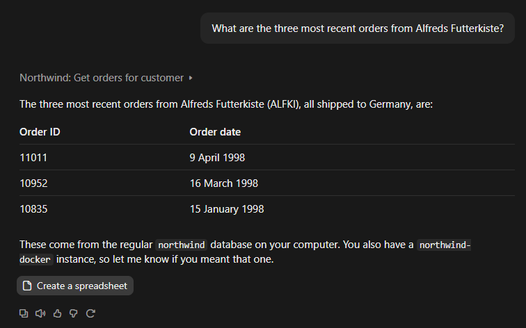

# Northwind OData MCP Server


An [MCP](https://modelcontextprotocol.io) server that lets an AI agent query the public
Northwind OData service in plain language. It exposes four read-only tools (customers, orders,
product categories, products), is covered by unit tests, ships as a Docker image, and is
checked and published by a GitHub Actions pipeline.

> **A note on AI assistance.** I built this project as a learning exercise with the help of
> generative AI (Claude, by Anthropic). It is a portfolio project, not production software.

## Demo



Example questions an agent can answer by chaining the tools:

- "Which customers in Germany have 'futter' in their name?"
- "What are the three most recent orders from Alfreds Futterkiste?"
- "List the product categories, then show me the products in Beverages."

The second question shows the chaining: the agent finds the customer first, then fetches
that customer's orders.

## Tools

| Tool | Parameters | What it does |
|---|---|---|
| `list_customers` | `name`, `country`, `top` | Searches customers. `name` matches any part of the company name, case-insensitive. `country` is an exact match. Both are optional and can be combined. |
| `get_orders_for_customer` | `customer_id` or `customer_name`, `top` | Returns recent orders, newest first. A partial name is resolved to a customer first; if several customers match, an error asks for a more specific name. |
| `list_categories` | none | Lists product categories, so the agent can discover valid names. |
| `get_products_by_category` | `category_name`, `top` | Lists products in a category with ID, name and unit price. |

Results are capped at 50 rows per call.

## How it works

```
 AI client                    This server                     Public API
 (Claude Desktop,    MCP     ┌────────────────────┐   HTTPS   ┌──────────────────┐
  MCP Inspector)  <────────> │ tools -> helpers   │ <───────> │ Northwind OData  │
                    stdio    │ build query, clean │   OData   │ (services.odata  │
                             │ results, raise     │           │  .org)           │
                             │ clear errors       │           └──────────────────┘
                             └────────────────────┘
```

The client starts the server and talks to it over standard input/output. The server turns each
tool call into an OData query (`$filter`, `$select`, `$orderby`, `$top`), sends it, and returns
cleaned-up rows.

## Getting started

### Prerequisites

- Python 3.10 or newer (CI and the Docker image use 3.13)
- Node.js, only if you want to use the MCP Inspector
- Docker Desktop, only if you want to run the container

### Run locally

```bash
python -m venv .venv
# Windows (PowerShell): .venv\Scripts\Activate.ps1
# macOS / Linux:        source .venv/bin/activate
pip install -r requirements-dev.txt
```

Try the tools in the browser-based Inspector:

```bash
npx @modelcontextprotocol/inspector python mpcserver.py
```

Click **Connect**, open the **Tools** tab, and run a tool.

### Connect to Claude Desktop

Add the server to `claude_desktop_config.json` (Settings, Developer, Edit Config), using
absolute paths, then fully quit and reopen Claude Desktop:

```json
{
  "mcpServers": {
    "northwind": {
      "command": "C:\\path\\to\\project\\.venv\\Scripts\\python.exe",
      "args": ["C:\\path\\to\\project\\mpcserver.py"]
    }
  }
}
```

### Run with Docker

```bash
docker build -t northwind-mcp .
npx @modelcontextprotocol/inspector docker run -i --rm northwind-mcp
```

The server speaks MCP over stdin/stdout, so the container needs `-i` and must not use `-t`.
To use it from Claude Desktop, replace the entry above with:

```json
"northwind-docker": {
  "command": "docker",
  "args": ["run", "-i", "--rm", "northwind-mcp"]
}
```

Rebuild the image after changing the code, because the container runs a copy made at build time.

## Testing

```bash
pytest
ruff check .
```

The unit tests replace `httpx.get` with a small recording fake, so they run in under a second,
need no network, and never touch the public demo server. They check that:

- each tool builds the right OData query (filters, ordering, column selection, row caps),
- quotes in user input are escaped,
- results are cleaned of metadata,
- name lookups handle zero, one and several matches,
- the server registers the expected tools with descriptions.

## CI/CD

The workflow in `.github/workflows/ci.yml` runs on every push to `main` and on pull requests:

1. **Lint and test:** installs the dev dependencies, runs `ruff` and `pytest`.
2. **Build and publish image:** runs only if step 1 passed. It builds the Docker image and, on
   pushes to `main`, publishes it to GitHub Container Registry as
   `ghcr.io/<your-github-username>/<repo-name>` (tags: `latest` and the commit SHA). On pull
   requests it builds without pushing.

## Design decisions

- **Thin tools, testable logic.** The `@mcp.tool()` functions only forward to plain helper
  functions, so the behavior can be unit-tested without MCP or the network.
- **Docstrings are the agent's interface.** An agent decides which tool to call from the name,
  parameters and description, so the descriptions say what each parameter matches and how
  tools relate (for example, that a name can be used instead of an ID).
- **Safe query building.** Single quotes in user input are doubled, as OData requires, so a
  value cannot break out of its string literal.
- **Bounded, clean results.** Row counts are clamped to 1-50, requests time out after 10
  seconds, and OData annotations such as `@odata.etag` are removed because they are noise for an
  agent. The server is read-only, so concurrency tokens are not needed.
- **Ambiguity is an error, not a guess.** When resolving a customer by name, the server asks for
  two rows and raises a clear message if more than one matches, so the agent can narrow its
  search.
- **stdio first.** It is the simplest transport and what local clients such as Claude Desktop
  expect.

## Limitations and next steps

- The data is the fictional Northwind sample (orders from 1997-1998), served by a public demo
  service that can be slow or unavailable.
- The server is read-only and uses stdio only. A Streamable HTTP mode, with authentication, would
  allow one shared deployment instead of one process per client.
- The tests use mocked HTTP; an optional set of live tests could check that the real service
  still behaves as expected.
- Other ideas: tools for a REST and a GraphQL API to compare styles, a small agent script built
  on the Anthropic API, and pointing the same server design at a different OData service.

## Notes

- This project targets **version 2** of the MCP Python SDK (`MCPServer`, formerly `FastMCP`).
  Many tutorials still show version 1; see the
  [migration guide](https://py.sdk.modelcontextprotocol.io/v2/migration/).
- Data comes from the public OData sample service at `services.odata.org`. This project is
  independent and not affiliated with the service's owners.

## Project structure

```
.
├── mpcserver.py            # MCP server: helpers + tool definitions
├── tests/
│   └── test_server.py      # unit tests with a mocked HTTP layer
├── requirements.txt        # runtime dependencies
├── requirements-dev.txt    # adds pytest and ruff
├── pytest.ini
├── Dockerfile
├── .dockerignore
└── .github/workflows/ci.yml
```